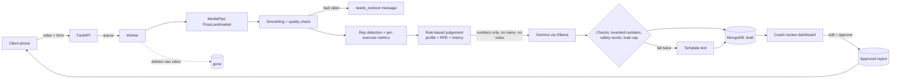

# Architecture

## Modules (backend/app)

| Module | Job |
|---|---|
| `pose/landmarker.py` | MediaPipe Tasks `PoseLandmarker` (VIDEO mode) -> `PoseSequence`; overlay video writer |
| `pose/smoothing.py`, `quality.py`, `angles.py` | Clean jitter, fill short gaps, quality report, joint angle helpers |
| `pose/exercises/*` | `squat`, `pushup`, `bicep_curl` analyzers; thresholds in a config dataclass at the top of each file |
| `pose/synthetic.py` | Fake skeletons for tests and demo data |
| `pipeline.py` | Landmarks -> quality + reps + set metrics |
| `analysis/metrics.py` | Set metrics, velocity loss, form score (weights in DECISIONS.md) |
| `analysis/judgement.py` | Flags + fatigue + relative load + safety/conservative mode + progress vs last 3 |
| `analysis/progress.py` | Trend and comparison over sessions |
| `analysis/activity.py` | Heatmap days, quartile levels, streaks, exercise cards, feed, badges (no LLM) |
| `llm/ollama_client.py` | Structured-output chat, retries, invalid-JSON retry with the error attached |
| `llm/prompts.py`, `schemas.py`, `reports.py` | Prompts with safety rules, JSON schemas, generation + validation + fallbacks, plan clamp |
| `jobs/worker.py` | In-process queue, session processing, recovery, overlay cleanup |
| `routers/*` | `coach` (auth, clients, plans), `client_portal` (`/c/{token}`, upload), `sessions` (review, approve, overlay, voice) |
| `tts/elevenlabs.py` | Optional voice note |

## Privacy

Raw video is deleted right after processing. Only numbers and text are stored. Gemma never sees video, images or the client's name. The skeleton overlay lives only until the coach approves (max 7 days).

## Frontend

Next.js App Router. `/c/[token]` (client home, upload, GitHub-style training page), `/dashboard`, `/clients/[id]`, `/sessions/[id]` (coach). The training dashboard component is shared between client and coach.
